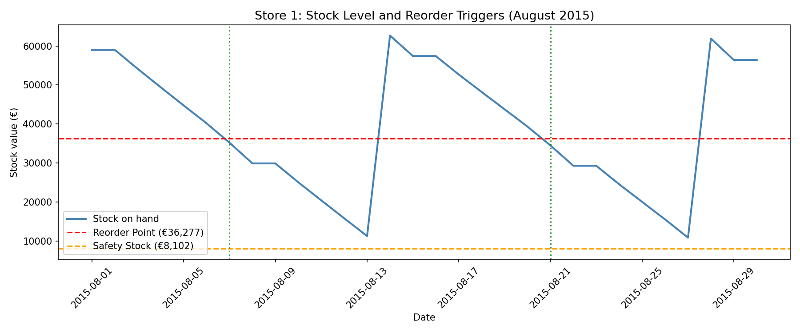

# 📦 Inventory Optimisation Report: Reorder Points and Safety Stock

*Task 4: Inventory Optimisation Engine | CPUT Data Science Capstone*

---

## 📦 Overview

- 🏪 **Stores covered:** 1,115
- 📅 **Forecast period:** 1 August to 30 August 2015 (30 days)
- 🔢 **Total predictions generated:** 33,450 (1,115 stores × 30 days)
- 🤖 **Model used:** XGBoost, loaded from `models/xgboost_model.pkl` (selected in Task 3, MAPE 22.77%)
- ⏱️ **Assumed lead time:** 7 days
- 🎯 **Assumed service level:** 95% (Z-score 1.65)

---

## 🎯 Objective

To turn the demand forecasts from Task 3 into two practical numbers for every store: a **Reorder Point** (the stock level at which a new order should be placed) and a **Safety Stock** (a buffer against unexpected demand).

---

## ⚙️ Method

### Step 1: Load the saved model
The trained XGBoost model was loaded from disk instead of being retrained.

### Step 2: Recreate the features
The same 12 features used in Task 3 were rebuilt: `Store`, `DayOfWeek`, `Year`, `Month`, `DayOfMonth`, `WeekOfYear`, `Promo`, `SchoolHoliday`, `StoreType_encoded`, `Assortment_encoded`, `CompetitionDistance`, `Promo2`.

### Step 3: Build the future feature table
30 future dates were created after the last date in the dataset (31 July 2015). For every store and every date, one row was built, giving **33,450 rows**.

| Feature | How it was filled for future dates |
|---|---|
| Date features (Year, Month, DayOfMonth, WeekOfYear, DayOfWeek) | Calculated from the date |
| StoreType, Assortment, CompetitionDistance, Promo2 | Copied from each store's existing record |
| Promo | **Assumed 0** (no future promotion schedule available) |
| SchoolHoliday | **Assumed 0** (no future holiday calendar used) |

### Step 4: Generate forecasts
XGBoost predicted sales for all 33,450 rows. Negative predictions were replaced with 0 using `.clip(lower=0)`.

### Step 5: Calculate inventory metrics per store

| Metric | Formula |
|---|---|
| Average daily demand | Mean of the 30 predicted daily values |
| Standard deviation of demand | Standard deviation of the 30 predicted daily values |
| Safety Stock | `Z × Std Dev × √Lead Time` |
| Reorder Point | `Average Daily Demand × Lead Time + Safety Stock` |

With Z = 1.65 and Lead Time = 7 days.

---

## 📊 Results

### Across all 1,115 stores

| Measure | Value |
|---|---|
| Average daily demand per store | €4,798 |
| Average safety stock per store | €9,043 |
| Average reorder point per store | €42,627 |
| Highest reorder point | Store 262: €133,986 |
| Lowest reorder point | Store 841: €22,219 |

### Example: Store 1

| Measure | Value |
|---|---|
| Average daily demand | €4,025 |
| Std deviation of daily demand | €1,856 |
| Total forecasted sales (30 days) | €120,750 |
| Safety stock | €8,102 |
| Reorder point | €36,277 |

### What the store types show
A check of the store types confirmed:

| Store | Store Type | Note |
|---|---|---|
| 262 | b | Highest reorder point. Consistent with type b stores selling the most (Task 2). |
| 4 | c | Reorder point of €56,977. High demand, but not a type b store. |
| 841 | a | Lowest reorder point. The data does not tell us why its demand is lower. |

Store type alone does not explain which stores have high demand. Store 4 is high-selling without being type b.

---

## 📈 Forecast Pattern (Store 1)

The predicted daily sales for Store 1 follow the weekly pattern found in the EDA: roughly €4,500 to €5,500 on trading days and €0 on Sundays.

---

## 🧪 Stock Simulation (Store 1)

A simple simulation was run to show how the reorder rule behaves. Stock falls each day by the predicted sales. When stock drops to the reorder point, an order is placed, and it arrives after the 7-day lead time.

### Simulation assumptions
These were chosen to illustrate the rule. They did not come from the data:
- **Starting stock:** the reorder point plus 7 days of average demand
- **Order size:** 14 days of average daily demand
- **One open order at a time**

### What the simulation showed
- Orders were placed on **day 7 (7 August)** and **day 21 (21 August)**, when stock reached the reorder point of €36,277.
- Each delivery arrived 7 days after the order.
- Stock never reached the safety stock level (€8,102). The lowest point was about €11,000, just before each delivery.

This shows how the reorder rule works under these assumptions. It is **not** a measured result.

---

## ⚠️ Limitations

1. **Values are in Euros of sales, not units of stock.** The `Sales` column is a money amount, so reorder points and safety stock are also money values. A real shop owner needs units. A later step would convert these using product prices.
2. **Sunday zeros inflate safety stock.** Sundays are predicted as 0, which makes daily demand look very variable (Store 1: standard deviation €1,856 on an average of €4,025). Because safety stock is based on that standard deviation, it is larger than it needs to be. Calculating the standard deviation on trading days only would be more accurate.
3. **Future promotions and school holidays were assumed to be zero.** Our EDA showed promotions raise sales by about 81%, so if a promotion runs in August, demand will be underestimated.
4. **The forecasts were not checked against real August 2015 sales.** The dataset ends on 31 July 2015. The only accuracy evidence is the Task 3 test result (MAPE 22.77%), so reorder points inherit that level of error.
5. **The safety stock formula assumes a normal distribution of demand** and independent daily demand. Retail demand with promotions and Sunday closures does not perfectly fit this.
6. **The 7-day lead time and 95% service level are assumptions.** Real values depend on each supplier and business.
7. **The stock simulation uses assumed starting stock and order size** and covers one store only.

---

## 💾 Saved Outputs

| File | Location | Contents |
|---|---|---|
| `inventory_recommendations.csv` | `data/` | Reorder point and safety stock for all 1,115 stores |
| `09_stock_simulation_store1.png` | `outputs/` | Stock level and reorder triggers for Store 1 |

---

## 🚀 Next Steps

- Convert Euro values into units using product prices
- Calculate safety stock using trading days only
- Add planned promotions as a feature when forecasting
- Build the Streamlit dashboard so a shop owner can view forecasts and reorder points

---

## 🛠️ Tools Used

`Python` · `pandas` · `numpy` · `joblib` · `matplotlib` · `xgboost` · `Jupyter Notebook`

---
*📌 This report was generated as part of Task 4: Inventory Optimisation Engine of the CPUT Data Science Capstone Project.*